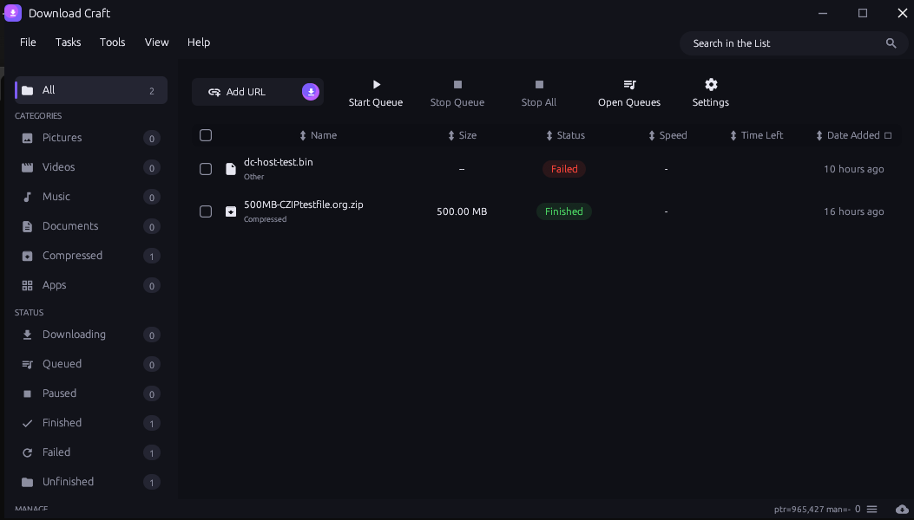

# Download Craft



A lightweight, offline-first download manager for Windows, written in pure
Rust with an `egui` GUI. Multi-connection segmented HTTP(S) downloads,
queue management, scheduler, browser-extension integration, and a CLI that
shares the same queue.

MIT licensed — free for open-source, closed-source, and commercial use.
See `LICENSE`. Interface design inspired by modern download managers.

## Features

- Segmented downloads (1–16 connections) with resume via HTTP Range.
- Global speed limit (token-bucket), per-download connection control.
- Automatic filename detection (Content-Disposition, video pages), safe
  auto-rename (`name (1).ext`) or optional overwrite.
- Optional SHA-256 integrity verification (Add dialog, Details, CLI), plus
  on-demand "Verify checksum" for finished files.
- Queue with concurrency limit, scheduler, retry-all-failed, finish actions
  (nothing / shutdown / sleep / hibernate), import/export URL lists.
- Clipboard URL detection, desktop notifications, system tray, antivirus hook.
- Status sidebar with live counts, search, sortable/resizable
  columns, per-segment progress view, dark/black/light themes.
- CLI (`add/list/download/get/remove/redownload/clear/import/export/status`)
  and browser native-messaging host (Chrome/Edge/Firefox) sharing
  `%APPDATA%\download_craft\queue.json`.

## Build (Windows)

Prerequisites: Rust stable (https://www.rust-lang.org/tools/install),
MSVC build tools for the `gnu`/`msvc` target.

```powershell
cargo build            # debug: target\debug\download_craft.exe
cargo build --release  # portable release: target\release\download_craft.exe
cargo test             # unit + local HTTP engine matrix (no network needed)
```

The release exe is portable: copy it anywhere and run it. History and
settings stay in `%APPDATA%\download_craft\` (`queue.json`, `ui.json`).
Upgrading from the old `idm_rust` build? Your queue and settings move over
automatically on first launch.

## Run

- GUI: launch `download_craft.exe`.
- CLI: `download_craft.exe add "https://example.com/file.zip"`,
  `download_craft.exe get "https://example.com/file.zip" -o out.zip`,
  `download_craft.exe --help` for all commands.
- Browser extension: load `browser-extension/` unpacked once, then use
  Settings → Browser integration → Install (Chrome/Edge/Firefox).

## Licenses

MIT — see `LICENSE` (replace the placeholder copyright line with your name
before publishing). `NOTICE.md` lists attributions for bundled third-party
assets (Material Icons font) and design inspirations.
