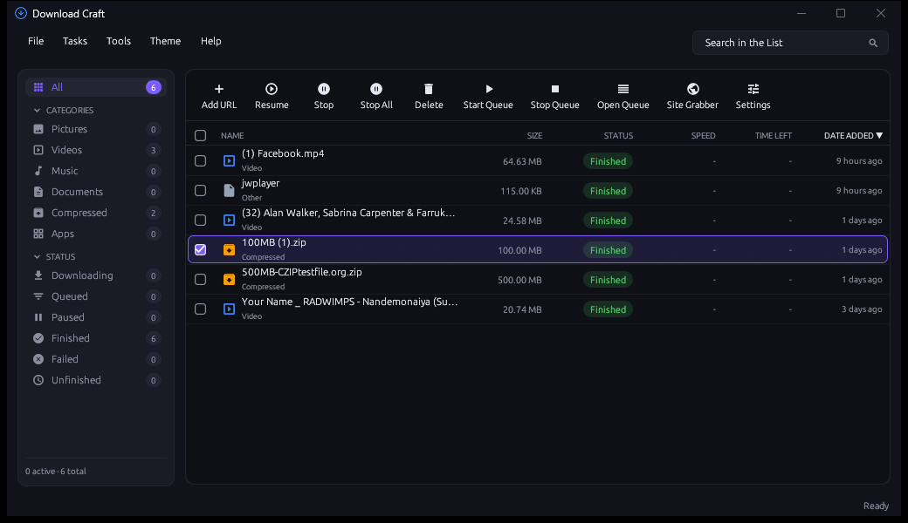
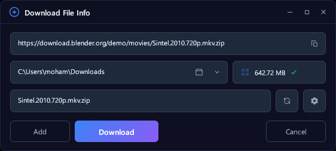
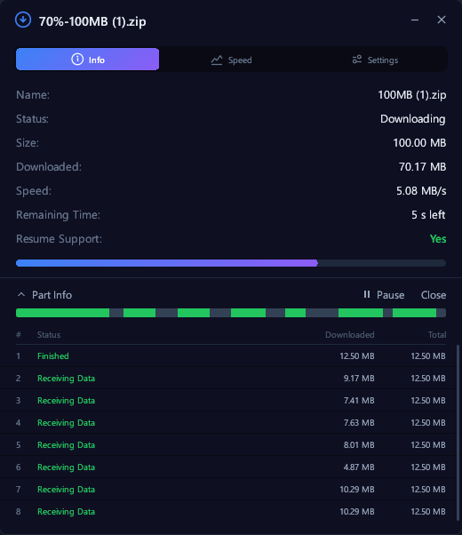
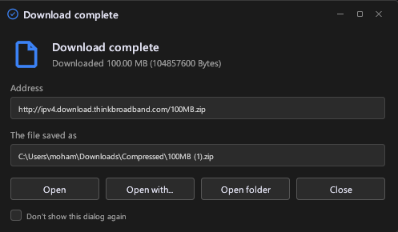
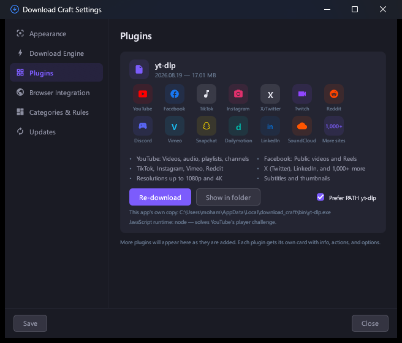
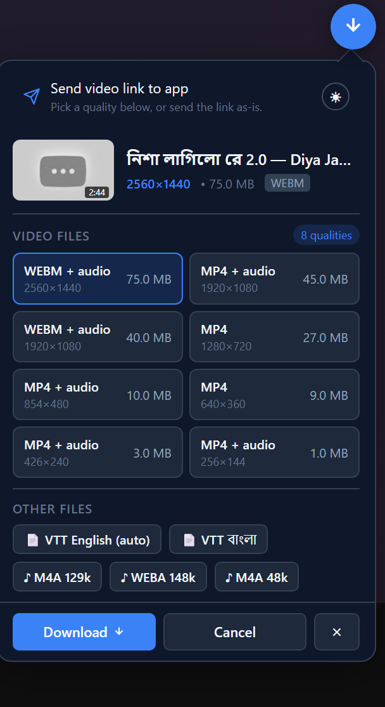

# Download Craft



A lightweight, offline-first download manager for Windows, written in pure
Rust with an `egui` GUI. Multi-connection segmented HTTP(S) downloads,
queue management, scheduler, browser-extension integration, and a CLI that
shares the same queue.

MIT licensed — free for open-source, closed-source, and commercial use.
See `LICENSE`. Interface design inspired by modern download managers.

## Screenshots

Capture a link and start it — the app probes the URL for its name and size
before the transfer begins:

<p align="center">
  
</p>

Watch it transfer — live speed, remaining time, and every parallel segment:

<p align="center">
  
</p>

And when it lands, open it, open its folder, or just close the dialog:

<p align="center">
  
</p>

Settings is a full window of its own — iconed sections, and the browser
helper under **Plugins**:

<p align="center">
  
</p>

In the browser, the picker sits on the video itself: qualities with sizes,
subtitle tracks and audio-only files, sent straight to the app:

<p align="center">
  
</p>

## Features

- Segmented downloads (1–16 connections) with resume via HTTP Range.
- Global speed limit (token-bucket), per-download connection control.
- Automatic filename detection (Content-Disposition, video pages), safe
  auto-rename (`name (1).ext`) or optional overwrite.
- Optional SHA-256 integrity verification (Add dialog, Details, CLI), plus
  on-demand "Verify checksum" for finished files.
- Queue with concurrency limit, scheduler, retry-all-failed, finish actions
  (nothing / shutdown / sleep / hibernate), import/export URL lists.
- YouTube and 1,000+ other yt-dlp-supported sites: the app fetches and keeps
  its own yt-dlp up to date, which is what makes 1080p+ and merged
  audio+video work. Settings → Plugins shows the copy in use, its version and
  the JavaScript runtime, with Re-download / Show in folder beside it; the
  card's grid names the sites that come up most.
- Clipboard URL detection, desktop notifications, system tray, antivirus hook.
- Status sidebar with live counts, search, sortable/resizable columns,
  toolbar bulk actions (Resume / Stop / Stop All / Delete), a per-segment
  progress view, and System / Dark / Light themes.
- File names render in any script (Bangla, Arabic, CJK, …) instead of boxes;
  the Indic scripts (Bengali, Devanagari, Tamil, …) are shaped properly —
  conjuncts and matra reordering — not drawn one codepoint at a time.
- CLI (`add/list/download/get/remove/redownload/clear/import/export/status`)
  and browser native-messaging host (Chrome/Edge/Firefox) sharing
  `%APPDATA%\download_craft\queue.json`.

## Build (Windows)

Prerequisites: Rust stable (https://www.rust-lang.org/tools/install),
MSVC build tools for the `gnu`/`msvc` target.

```powershell
cargo build            # debug: target\debug\download_craft.exe
cargo build --release  # portable release: target\release\download_craft.exe
cargo test             # unit + local HTTP engine matrix (no network needed)
```

The release exe is portable: copy it anywhere and run it. History and
settings stay in `%APPDATA%\download_craft\` (`queue.json`, `ui.json`).
Upgrading from the old `idm_rust` build? Your queue and settings move over
automatically on first launch.

## Run

- GUI: launch `download_craft.exe`.
- CLI: `download_craft.exe add "https://example.com/file.zip"`,
  `download_craft.exe get "https://example.com/file.zip" -o out.zip`,
  `download_craft.exe --help` for all commands.
- Browser extension: load `browser-extension/` unpacked once, then use
  Settings → Browser integration → Install (Chrome/Edge/Firefox).

## Licenses

MIT — see `LICENSE` (replace the placeholder copyright line with your name
before publishing). `NOTICE.md` lists attributions for bundled third-party
assets (Material Icons font) and design inspirations.
